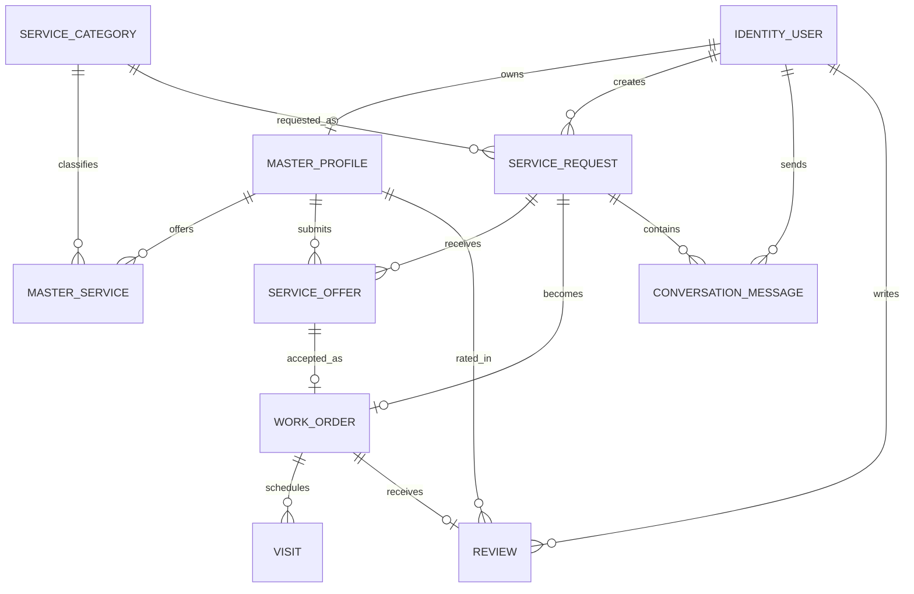
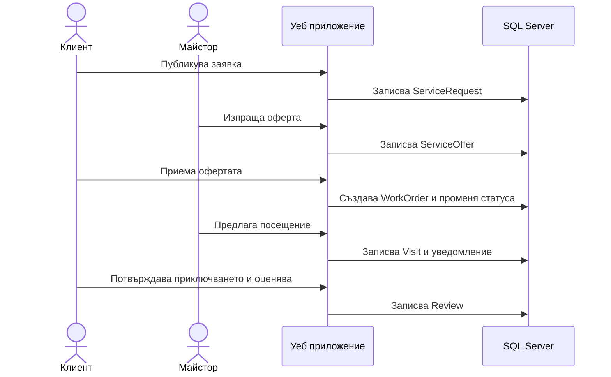

# Архитектура и модел на данните - първа версия

## Технологичен избор

Приложението е ASP.NET Core MVC с Razor изгледи, ASP.NET Core Identity, Entity Framework Core и Microsoft SQL Server. Индивидуалното задание задава минимум .NET 8; локалната среда разполага с .NET 10 SDK. Използваме .NET 10 LTS, защото е наличен в средата и има по-дълъг период на поддръжка от .NET 8 към датата на началото на разработката [3]. Microsoft поддържа официално SQL Server provider за EF Core и MVC примери с EF Core [4].

## Слоеве

1. **Представяне:** Razor изгледи, ViewModels, клиентска валидация и достъпна навигация.
2. **Уеб слой:** MVC контролери, авторизация, обработка на заявки и връщане на изгледи.
3. **Бизнес логика:** услуги за оферти, поръчки, посещения, оценки и уведомления. Тук се проверяват позволените преходи между статусите.
4. **Достъп до данни:** `ApplicationDbContext`, EF Core конфигурации и миграции.
5. **Съхранение:** MS SQL Server; LocalDB за локално разработване.

Контролерите ще получават зависимостите си чрез Dependency Injection и няма да съдържат директно сложна бизнес логика.

## Кандидат за Design Pattern

Ще използваме **Strategy Pattern** за каналите за уведомяване. Общ интерфейс за изпращане на уведомление позволява отделно да се добавят вътрешни известия и, ако остане време, електронна поща. Така бизнес логиката за поръчки не зависи от конкретния канал. Първоначално ще се реализира вътрешно известие; имейлът е разширение.

## Основни компоненти

- `IdentityUser` и Identity роли `Client`, `Master`, `Admin`.
- Домейн модели: `MasterProfile`, `ServiceCategory`, `MasterService`, `ServiceRequest`, `ServiceOffer`, `WorkOrder`, `Visit`, `ConversationMessage`, `Review`.
- Контролери: `CategoriesController`, `MastersController`, `RequestsController`, `OffersController`, `VisitsController`, `ReviewsController`, плюс административна зона.
- Сервизни класове: `OfferService`, `WorkOrderService`, `VisitService`, `NotificationService`.

## Начална ER диаграма

## Основни данни

| Модел | Предназначение | Ключови данни |
|---|---|---|
| `MasterProfile` | Професионален профил, подлежащ на одобрение | Identity user, име за показване, описание, град, статус |
| `ServiceCategory` | Каталог от видове услуги | име, описание, активност |
| `MasterService` | Връзка между майстор и категория | майстор, категория, начална цена, мерна единица |
| `ServiceRequest` | Заявка на клиент | клиент, категория, описание, град, бюджет, желан период, статус |
| `ServiceOffer` | Предложение на майстор | заявка, майстор, цена, срок, съобщение, статус |
| `WorkOrder` | Договорената работа след приемане на оферта | заявка, избрана оферта, клиент, майстор, цена, статус |
| `Visit` | Планирано посещение | поръчка, начало/край, статус, бележка |
| `ConversationMessage` | Съобщение между участниците | заявка, подател, текст, дата |
| `Review` | Оценка след завършена работа | поръчка, автор, майстор, оценка 1-5, коментар |

## Последователност на основния сценарий

## Ключови правила за данните

- Профилът на майстор не се показва в търсенето преди одобрение от администратор.
- За една заявка клиентът може да приеме най-много една оферта.
- Оферта може да изпрати само одобрен майстор.
- Оценка може да бъде оставена само от клиент по завършена поръчка и най-много веднъж.
- Клиентът и майсторът имат достъп само до свои заявки, поръчки, посещения и съобщения.
- Точният адрес на обекта не се показва публично.

## Източници

Номерата в квадратни скоби съответстват на общия списък в [`references.md`](references.md).

